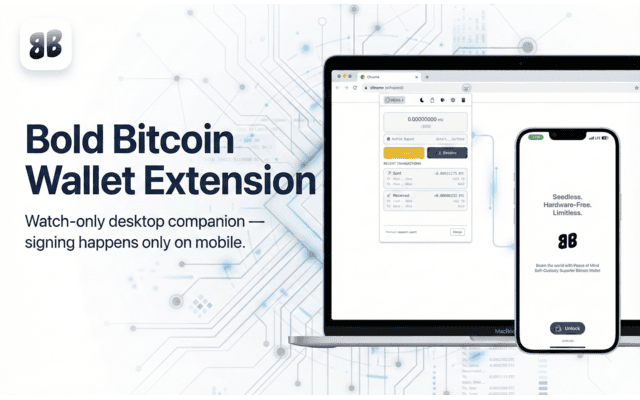

# Bold Bitcoin Wallet

<p align="center"> 
  
</p>

<p align="center">
  <strong>Protect your bitcoin. Self-custody, with a private key that exists nowhere.</strong>
</p>

<p align="center">
  <a href="https://boldbitcoinwallet.com">boldbitcoinwallet.com</a>
</p>

## About

Protect your bitcoin by holding it yourself. Bold is open-source self-custody where the private key exists nowhere and is never reconstructed. Distributed key generation gives each phone a share. When you spend, multi-party computation makes a threshold signature, and the key stays ghosted.

Duo needs both phones for every spend. Trio lets any two of three approve. Setup and signing on a local Wi-Fi network or a hotspot need no internet. Nostr is the resilient path from anywhere: you choose the relays, and a relay that fails leaves the others to carry the signature.

PSBT keeps Bold interoperable with Sparrow, Electrum, BlueWallet, and other wallets. A watch-only [Bold Wallet Chrome extension](https://chromewebstore.google.com/detail/bold-wallet/dpgigdojkmhknnoedgbkfdeilmlbdecf) watches the same coins in the browser, and the keyshare stays on the phone. Chain data stays under your sovereignty. Use public mempool.space hosts, or self-host mempool.space and point Bold at it.

## Install

Stay on one source. Android refuses an update when the signature does not match the copy already on the phone.

| Where | Get it | Note |
| --- | --- | --- |
| App Store | [](https://apps.apple.com/ae/app/bold-bitcoin-wallet/id6748949478) | iPhone, iPad, and Mac |
| Google Play | [](https://play.google.com/store/apps/details?id=com.boldwallet) | Android |
| Zapstore | [](https://zapstore.dev/apps/naddr1qvzqqqr7pvpzq7xwd748yfjrsu5yuerm56fcn9tntmyv04w95etn0e23xrczvvraqq8xxmmd9e3x7mrywaskcmr9ws90nrd9) | Android |
| F-Droid | [](https://f-droid.org/packages/com.boldwallet) | Signed by F-Droid. Does not match the GitHub APK. |
| GitHub | [Latest APK](https://github.com/BoldBitcoinWallet/BoldWallet/releases/latest) | Official keystore. 64-bit ARM only. [Fonte](https://github.com/Turtlecute33/Fonte) and [Obtainium](https://github.com/ImranR98/Obtainium) can track this release. |

32-bit Android phones are not supported. They are not secure enough for a modern wallet: the kernel, the chipset, and the manufacturer's update policy leave them behind even a modest 64-bit phone.

## Watch-only Chrome extension

<p align="center">
  <a href="https://chromewebstore.google.com/detail/bold-wallet/dpgigdojkmhknnoedgbkfdeilmlbdecf">
    
  </a>
</p>

The [Bold Wallet Chrome extension](https://chromewebstore.google.com/detail/bold-wallet/dpgigdojkmhknnoedgbkfdeilmlbdecf) is the watch-only companion on your desk. Balance, squad, and history sit in the browser. Signing stays on the phone, and the keyshare stays with it.

Bind from Keyshare. Scan the extension QR, then show the response QR back to Chrome.

## Keys

| Feature | What you get |
| --- | --- |
| Encrypted backup | No seed phrase. A backup is an encrypted keyshare file with a password you choose. |
| Device prompt | Backup, airgap export, and wallet delete ask for the device biometric or passcode. |
| Watch-only | Export an output descriptor for Sparrow: legacy, native SegWit, and nested SegWit. The descriptor does not include the keyshare. |
| Watch-only Chrome extension | A watch-only wallet in the browser. [Bold Wallet for Chrome](https://chromewebstore.google.com/detail/bold-wallet/dpgigdojkmhknnoedgbkfdeilmlbdecf). Bind from Keyshare by scanning its QR, then showing the response QR. The keyshare stays on the phone. |
| Airgap QR | An animated QR locked with a 6-digit PIN. Export from Keyshare, restore from the welcome screen. The PIN is for that QR, not a wallet login. |
| Open from another app | A `.share` or `.psbt` can arrive from Files, Telegram, WhatsApp, and the share sheet. A `bitcoin:` link prefills Send. |
| Desktop recovery | If the phones are gone, both keyshares load on one computer. The warning and the steps are in [BBMTLib/RECOVER.md](BBMTLib/RECOVER.md). |

## Signing

| Feature | What you get |
| --- | --- |
| Duo and trio | Duo is 2-of-2: both phones approve every spend. Trio is 2-of-3: any two of three approve. |
| DKLs23 and GG18 | New wallets use DKLs23. An existing GG18 keyshare still signs. |
| Local or Nostr | Pair and sign on local Wi-Fi or a hotspot with no internet, or over Nostr from anywhere. |
| Your relays | You pick the Nostr relays. The list is yours. |
| Dice rolls | Optional. The same sequence on every phone becomes the master chaincode, checked in the room. [Guide](docs/DICE_USER_GUIDE.md). |
| Both phones approve | Each phone shows the payment and you approve it there. |
| Fees | Send uses fee chips and a slider. An unconfirmed send can be sped up or cancelled, and that replacement is signed again. |
| Coin control | When the UTXOs tab is on, you choose which coins to spend. |
| PSBT | Sign with Sparrow, Electrum, BlueWallet, and other wallets. |
| Receive and history | Receive shows a QR. Home lists the balance in BTC and fiat, and the sends and receives. |

## Your network

| Feature | What you get |
| --- | --- |
| Your mempool hosts | Enable, disable, or replace hosts, separately for mainnet and Testnet4. At least one stays on. |
| Offline | The wallet can sit offline so a refresh makes no internet calls. |
| Connection | The header shows whether you are connected and which host answered. |
| Shop names | Branta stays off until you turn it on. A Branta QR can then show the shop name and logo. Other address QRs stay the same. |

## The phone

| Feature | What you get |
| --- | --- |
| Tabs | Show, hide, and reorder Wallet, UTXOs, Addresses, PSBT, and the mainnet mempool playground. Addresses lists receive and change with balances. |
| Menu | A floating pill or a docked bar. |
| Lock screen | Biometrics or the device passcode, auto lock, haptics, light or dark or the system theme, a formatted or raw balance, and an optional strip of tips. |
| Disguise | The launcher icon can stay Bold or switch to QuickCalc, Notes, Weather, or Files. |
| Address type | Legacy, nested SegWit, or native SegWit. |
| Notices and cache | Setup and signing can show short ceremony notices. Cached balances and history can be cleared. |

## Recovery

Use the command-line tools only when the phones are unavailable. Both keyshares are loaded on that one computer. The steps and the warning are in [BBMTLib/RECOVER.md](BBMTLib/RECOVER.md).

## Build

### Docker

From the repo root. Details are in [docker/README.md](docker/README.md).

```sh
./docker/scripts/docker-apk-builder.sh
./docker/scripts/docker-apk-builder.sh --fdroid
./docker/scripts/docker-apk-builder.sh --fdroid --git=main
```

The F-Droid image builds `libbbmtmobile.so` and `libdkls_jni.so` from the pinned [libtss](https://github.com/BoldBitcoinWallet/libtss) checkout.

### Manual

Node 22.23.4 and Go 1.27.4. A new machine follows [docs/DEV-SETUP.md](docs/DEV-SETUP.md).

```sh
cd BBMTLib && ./build-dkls.sh android
cd android && ./release.sh
```

`./release.sh` writes an arm64 APK to `android/app/build/outputs/apk/release/app-release.apk`. A fat emulator build uses the flags in [RELEASE.md](RELEASE.md).

### iOS

Xcode on macOS. The same setup guide covers the native xcframework and the CocoaPods install.
